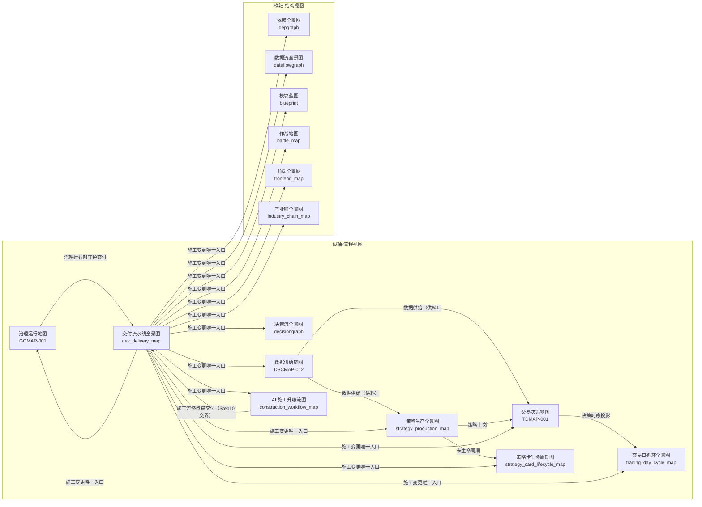

# 全景总图（图之图）

> 机生渲染，禁手改后不回生成。真源: config/panorama_master_map.yaml（nodes=15 edges=21 | 纵轴=9 横轴=6）；对账基准: docs/01_policies_and_standards/sop/governance_sop/alignment_checklist.md §3（在册 15 图，双闭校验随生成器）。

